# Diagrama de Classes — FTV World

Diagrama das **11 Models** reais do projeto (`backend/models/`), com atributos (colunas), chaves estrangeiras (FK) e métodos.
Métodos marcados com `$` são `@staticmethod`. O CRUD simples (`salvar`, `listar_todos`, `buscar_por_id`, `atualizar`, `deletar`) é feito pela própria Model; consultas especiais ficam em `backend/repositories/`.

```mermaid
classDiagram
    direction LR

    class Usuario {
        +int id PK
        +string nome
        +string email
        +string senha
        +string telefone
        +date data_nascimento
        +string nivel
        +string cidade
        +string tipo
        +string perna
        +string sexo
        +string habilidades
        +string local
        +decimal valor
        +text bio
        +text foto
        +text video
        +string video_url
        +boolean adm
        +boolean bloqueado
        +boolean aceitou_termos
        +datetime data_aceite_termos
        +datetime data_criacao
        +tuple CAMPOS_PUBLICOS$
        +to_dict()
        +to_public_dict()
        +salvar(dados)$
        +listar_todos()$
        +buscar_por_id(id)$
        +atualizar(id, dados)$
        +deletar(id)$
    }

    class Campeonato {
        +int id PK
        +string nome
        +text descricao
        +date data
        +time horario
        +string categoria
        +string nivel
        +string genero
        +int vagas_total
        +int vagas_disponiveis
        +string status
        +string cidade
        +decimal premio
        +text foto
        +int id_dono FK
        +to_dict()
        +salvar(dados)$
        +listar_todos()$
        +buscar_por_id(id)$
        +atualizar(id, dados)$
        +deletar(id)$
    }

    class Quadra {
        +int id PK
        +string nome
        +string endereco
        +string cidade
        +int numero_quadras
        +string contato
        +string modo
        +decimal preco
        +text descricao
        +text foto
        +int id_responsavel FK
        +to_dict()
        +salvar(dados)$
        +listar_todos()$
        +buscar_por_id(id)$
        +atualizar(id, dados)$
        +deletar(id)$
    }

    class Dupla {
        +int id PK
        +string nome
        +int id_usuario1 FK
        +int id_usuario2 FK
        +string categoria
        +boolean ativa
        +to_dict()
        +salvar(dados)$
        +listar_todos()$
        +buscar_por_id(id)$
        +atualizar(id, dados)$
        +deletar(id)$
    }

    class Inscricao {
        +int id PK
        +string status
        +date data_inscricao
        +int id_campeonato FK
        +int id_dupla FK
        +to_dict()
        +salvar(dados)$
        +listar_todos()$
        +buscar_por_id(id)$
        +atualizar(id, dados)$
        +deletar(id)$
    }

    class Partida {
        +int id PK
        +string fase
        +int placar_dupla1
        +int placar_dupla2
        +datetime data_hora
        +string status
        +int id_campeonato FK
        +int id_dupla1 FK
        +int id_dupla2 FK
        +int id_dupla_vencedora FK
        +int id_quadra FK
        +to_dict()
        +salvar(dados)$
        +listar_todos()$
        +buscar_por_id(id)$
        +atualizar(id, dados)$
        +deletar(id)$
    }

    class Solicitacao {
        +int id PK
        +int id_de FK
        +int id_para FK
        +string status
        +date data_solicitacao
        +to_dict()
        +salvar(dados)$
        +listar_todos()$
        +buscar_por_id(id)$
        +atualizar(id, dados)$
        +deletar(id)$
    }

    class Notificacao {
        +int id PK
        +string mensagem
        +boolean lida
        +date data_envio
        +int id_usuario FK
        +to_dict()
        +salvar(dados)$
        +listar_todos()$
        +buscar_por_id(id)$
        +atualizar(id, dados)$
        +deletar(id)$
    }

    class Candidato {
        +int id PK
        +int id_usuario FK
        +string mensagem
        +datetime data_criacao
        +to_dict()
        +salvar(dados)$
        +listar_todos()$
        +buscar_por_id(id)$
        +atualizar(id, dados)$
        +deletar(id)$
    }

    class Log {
        +int id PK
        +datetime data_hora
        +string quem
        +string acao
        +to_dict()
        +salvar(dados)$
        +listar_todos()$
        +buscar_por_id(id)$
        +atualizar(id, dados)$
        +deletar(id)$
    }

    class Config {
        +string chave PK
        +text valor
        +valor_python()
        +to_dict()
        +listar_todos()$
        +buscar_por_chave(chave)$
        +salvar(chave, valor)$
        +deletar(chave)$
    }

    %% Relacionamentos. Legenda: *-- composição (o filho não existe sem o pai) | o-- agregação (o todo reúne partes que existem sozinhas) | --> associação
    %% O rótulo é a coluna FK. Não há herança entre as Models: todas herdam apenas de db.Model (SQLAlchemy).

    %% Agregação: a dupla reúne dois jogadores, que continuam existindo se a dupla for desfeita
    Usuario "1" o-- "*" Dupla : id_usuario1
    Usuario "1" o-- "*" Dupla : id_usuario2

    %% Composição: estes registros pertencem ao pai e saem junto com ele
    Usuario "1" *-- "*" Notificacao : id_usuario
    Usuario "1" *-- "0..1" Candidato : id_usuario
    Campeonato "1" *-- "*" Inscricao : id_campeonato
    Campeonato "1" *-- "*" Partida : id_campeonato

    %% Associações simples
    Usuario "1" --> "*" Campeonato : id_dono
    Usuario "1" --> "*" Quadra : id_responsavel
    Usuario "1" --> "*" Solicitacao : id_de
    Usuario "1" --> "*" Solicitacao : id_para
    Quadra "1" --> "*" Partida : id_quadra
    Dupla "1" --> "*" Inscricao : id_dupla
    Dupla "1" --> "*" Partida : id_dupla1
    Dupla "1" --> "*" Partida : id_dupla2
    Dupla "1" --> "*" Partida : id_dupla_vencedora
```

## Observações

- `Log` e `Config` não têm chave estrangeira: `Log.quem` guarda apenas o nome de quem executou a ação e `Config` usa `chave` como chave primária.
- `Candidato.id_usuario` é único (`unique=True`): cada jogador tem no máximo uma candidatura em "Encontre sua dupla".
- `Partida.id_dupla_vencedora` é calculada pelo service (não existe empate).
- `Usuario.senha` guarda apenas o hash; `to_dict()` nunca devolve esse campo.
- **Herança:** não há herança entre as Models do domínio; todas herdam diretamente de `db.Model`.
- **Composição:** `Notificacao` e `Candidato` pertencem a um `Usuario` (saem junto com a conta); `Inscricao` e `Partida` pertencem a um `Campeonato`.
- **Agregação:** `Dupla` reúne dois `Usuario`; ao desfazer a dupla (fica inativa) os jogadores continuam existindo.
